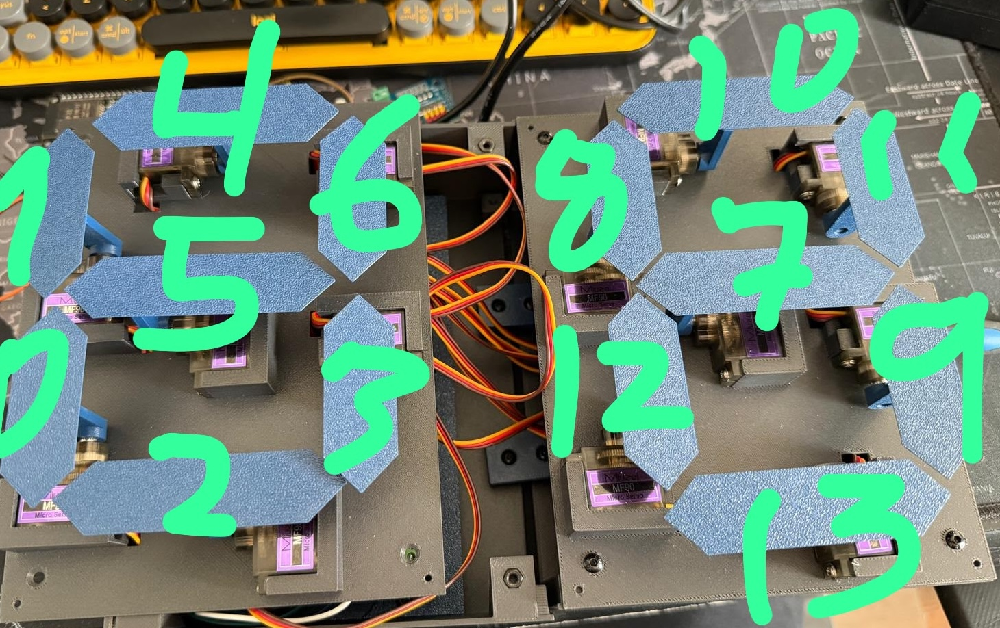

# Mechanical 7-Segment Countdown Clock — ESP32 Firmware

Firmware and electronics documentation for an original mechanical 7-segment countdown display, with two versions:

- **Single digit (0–9):** 7 independent MF90 micro servos.
- **Dual digit (00–99):** 14 independent MF90 micro servos.

The **ESP32** runs the controls and web server, and sends commands over **I²C** to a **PCA9685**. The PCA9685 generates PWM signals for each servo. The servos are powered by a **separate regulated 5 V supply** with a common ground.

> **3D model downloads are external.** This GitHub repository contains **firmware and electronics documentation only**, **not STL or 3MF model files**. Download the mechanical designs separately from the author's publication pages:

- [MakerWorld](<https://makerworld.com/es/models/3464388-single-dual-digit-0-9-00-99-esp32#profileId-3953675>)
- [MakerOnline](<https://www.makeronline.com/en/model/Single%20%26%20Dual%20Digit%20(0%E2%80%939%20%2F%2000%E2%80%9399)%20%7C%20ESP32/341311.html?trackModuleType=10>)
- [Other author platform](<https://space.snapmaker.com/en/model/44552-single-dual-digit-09-0099-esp32#profileId-48146>)

## Which firmware?

| | Single digit | Dual digit |
|---|---|---|
| Display range | `0–9` | `00–99` |
| MF90 micro servos | 7 | 14 |
| PCA9685 outputs | `CH0–CH6` | `CH0–CH13` |
| Sketch | [Single digit `.ino`](firmware/Countdown_Single_7_Servos/Countdown_Single_7_Servos.ino) | [Dual digit `.ino`](firmware/Countdown_Dual_14_Servos/Countdown_Dual_14_Servos.ino) |
| Wi-Fi AP | `RELOJ_0_9` | `RELOJ_SERVOS` |
| Calibration namespace | `reloj1` | `reloj` |

Both sketches are self-contained Arduino sketches with an embedded mobile-friendly web page. **Each built clock uses one ESP32 and one PCA9685**; install only the firmware matching that clock's servo count.

## Features

- Select any number in the supported range, show it mechanically and start a countdown.
- **Mobile rotary dial:** rotate to choose a number and press to start the countdown.
- Adjustable countdown interval and servo command speed.
- **All ON / All OFF** and playful randomised movement sequences within saved servo endpoints.
- Calibrate each servo's visible (`ON`) and hidden (`OFF`) position independently.
- Copy calibration values between channels and export/restore a text backup.
- Web interface offered over the ESP32's own Wi-Fi; no internet service or app is needed.

**Speed 100%** sends final position commands without software step-by-step interpolation. It **does not exceed the physical servo's rated speed**. Calibrate each mechanism and verify clearance before using turbo mode or automatic sequences.

## Components (per clock)

| Component | Single | Dual |
|---|---:|---:|
| MF90 micro servo | 7 | 14 |
| ESP32 DevKit board exposing GPIO21/GPIO22 | 1 | 1 |
| PCA9685 16-channel PWM driver | 1 | 1 |
| Regulated 5 V servo supply, sized to actual load | 1 | 1 |
| USB data/power cable for ESP32 | 1 | 1 |
| Servo leads, I²C jumper wires, supply wiring, fasteners, servo horns | As required | As required |

The original 14-servo electronics assembly uses a **5 V / 10 A servo supply**. Verify supply capacity and wiring for your own motors and simultaneous movement; the logic side of the PCA9685 is powered at **3.3 V** from the ESP32.

## Wiring

| ESP32 / power supply | PCA9685 |
|---|---|
| ESP32 `3V3` | `VCC` (logic voltage) |
| ESP32 `GND` | `GND` (common ground) |
| ESP32 `GPIO21` | `SDA` |
| ESP32 `GPIO22` | `SCL` |
| External supply `+5 V` | `V+` green terminal (servo power) |
| External supply `GND` | `GND` green terminal (servo return) |

**Never power 7 or 14 servos through the ESP32.** Connect every servo to a PCA9685 channel with brown/black to GND, red to V+, and yellow/orange to PWM, verifying the markings on the actual hardware. Keep power-supply and ESP32 grounds common.

### Servo-to-segment mapping

```text
         A
       -----
   F  |     |  B
       --G--
   E  |     |  C
       -----
         D
```

| Segment | Single | Dual left | Dual right |
|---|---:|---:|---:|
| A | CH4 | CH4 | CH10 |
| B | CH6 | CH6 | CH11 |
| C | CH3 | CH3 | CH9 |
| D | CH2 | CH2 | CH13 |
| E | CH0 | CH0 | CH12 |
| F | CH1 | CH1 | CH8 |
| G | CH5 | CH5 | CH7 |



## Install / flash

1. Install [Arduino IDE](https://www.arduino.cc/en/software), and install **esp32 by Espressif Systems** in Boards Manager. Boards Manager URL: `https://espressif.github.io/arduino-esp32/package_esp32_index.json`.
2. Install **Adafruit PWM Servo Driver Library** (and dependencies) through Library Manager.
3. Open the relevant `.ino` from its matching sketch folder. Select **ESP32 Dev Module** for the classic ESP32 board, and select the appropriate USB serial port.
4. For an existing calibrated ESP32, set **Erase All Flash Before Sketch Upload = Disabled**, keep its partition scheme unchanged, and save a calibration backup before updating.
5. Upload. Open Serial Monitor at **115200 baud** and connect to the Wi-Fi AP listed above (password: `12345678`).
6. Browse to **http://192.168.4.1** and use **Calibration** to set ON/OFF for every servo. Then use Numbers, Countdown, Dial and Dance.

**Calibration preservation:** Dual firmware uses `reloj` (`off0..off13`, `on0..on13`); single firmware uses `reloj1` (`off0..off6`, `on0..on6`). A full flash erase or a changed partition layout can remove the saved calibration. Backups can be exported and restored from the web interface.

For more detail, see the **[complete setup guide](docs/SETUP_GUIDE_EN.md)**, including the web UI and troubleshooting.

## Repository layout

```text
firmware/
  Countdown_Single_7_Servos/
    Countdown_Single_7_Servos.ino
  Countdown_Dual_14_Servos/
    Countdown_Dual_14_Servos.ino
docs/
  SETUP_GUIDE_EN.md
assets/
  original-14-servo-channel-map.jpg
README.md
```
